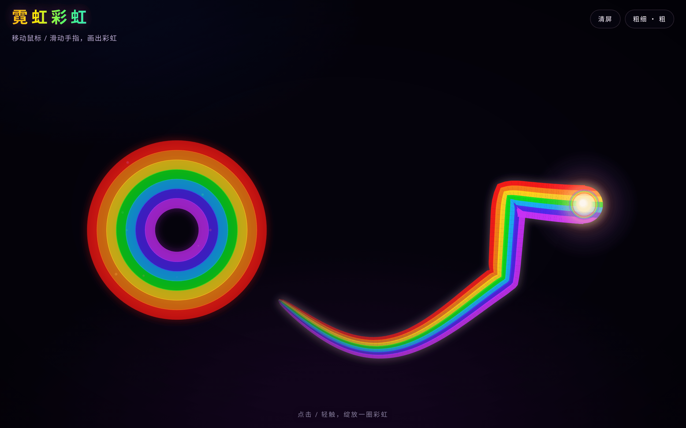

  

# Steven

吴事 · Hangzhou

## Sites · Some useless knick-knacks

### [Neon Rainbow · 霓虹彩虹](https://neon-rainbow-six.vercel.app)

An interactive neon rainbow toy with three modes. In Comet, hover to drag a glowing rainbow comet tail and click to bloom a rainbow ring; in Create, draw or write with a persistent rainbow brush, then undo or save as PNG; in Roam, fling the comet and watch it bounce off the screen edges.

### [Cyber Steven](https://cyber-steven.vercel.app)

A personal homepage in a cyber-neon gaming style, with a playful interactive terminal.

### [When CZ Wake](https://when-cz-wake.vercel.app)

A meme tiled into wallpaper, a vintage English clock on California time, and a whack-a-mole image that celebrates with confetti. A playful experiment. It does not track when anyone wakes up.

---

[HuskkyQ on GitHub](https://github.com/HuskkyQ)
